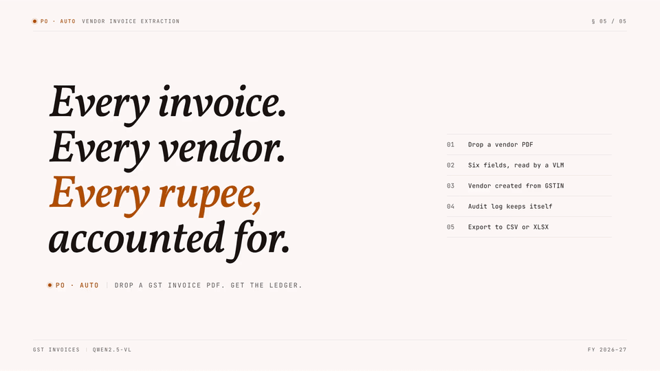

# PO Automation

> **Vendor invoice extraction for BuildCo Infra.** Drop a PDF → a vision-language model reads it → your accountant ships it → the audit log keeps itself.

Internal tool that replaces manual GST-invoice data entry. A Vision-Language Model (Qwen2.5-VL-7B) reads the invoice image directly and returns the six canonical fields — no per-vendor template setup, no OCR-and-regex stage.

| | |
|---|---|
| **Live demo** | <https://po-automation-i7xr.onrender.com> |
| **Stack** | Next.js 16 · Auth.js v5 · Prisma · PostgreSQL · Qwen2.5-VL-7B-AWQ |
| **Hosted on** | Render (web) · Supabase (Postgres) · Modal (GPU) |
| **Status** | Demo · iterating with the client |

---

## Demo

<a href="https://github.com/Shawn2110/PO-Automation/blob/main/docs/media/po-automation-demo.mp4"></a>

<sub>▶ Click the animation for the full-quality mp4 with sound.</sub>

Open the live URL and sign in with one of the seeded accounts (or click a quick-login chip on the landing page):

| Role | Email | Password | Can |
|---|---|---|---|
| Accountant | `accountant@buildco.in` | `accountant123` | Upload, edit, export |
| Viewer | `viewer@buildco.in` | `viewer123` | Read-only |

Drop any PDF on `/upload`. First extraction takes ~30–60s while the GPU spins up; subsequent uploads ~10s. The invoice appears on `/invoices` with extracted fields, vendor auto-created from the GSTIN, and an audit-log row for every change.

---

## Architecture

```
                  ┌────────────────────────────────┐
                  │  Next.js 16 (Render)           │
   PDF upload ───►│  ├─ /api/invoices/upload       │
                  │  ├─ runPipeline()              │
                  │  │   └─ runVlmExtract(bytes)─┐ │
                  │  └─ Prisma (writes)          │ │
                  └──────────────────────────────┼─┘
                                                 │
                  ┌──────────────────────────────▼─┐
                  │  Modal — GPU sidecar           │
                  │  (modal-vlm/app.py)            │
                  │  ├─ @app.cls(gpu="L4")         │
                  │  ├─ Qwen2.5-VL-7B-AWQ          │
                  │  └─ Starlette /extract         │
                  └────────────────────────────────┘
                                                 │
                                            stores │
                                                 ▼
                              ┌─────────────────────────────┐
                              │  Supabase Postgres          │
                              │  (User, Vendor, Invoice,    │
                              │   AuditLog, VendorTemplate) │
                              └─────────────────────────────┘
```

### Why a VLM instead of OCR?

Phase 1 used Tesseract + template matching (now in `archive/ocr-service/`). Every new vendor needed a one-time field-mapping UI before invoices could be parsed. With Qwen2.5-VL the model reads the image directly and returns the six fields as JSON in one call — new vendors just work. The trade-off is GPU cost (~$0.002 per invoice on Modal's L4) and a cold-start hit, both acceptable on Modal's $30/mo free tier.

---

## Repository layout

```
.
├── docs/                       PRD · architecture · build plan · agent spec
├── po-dashboard.jsx            Phase 0 static POC (1051 lines, reference only)
├── archive/ocr-service/        Phase 1 Tesseract sidecar (no longer deployed)
│
├── modal-vlm/                  Qwen2.5-VL-7B-AWQ on Modal L4
│   ├── app.py                  Modal app + Starlette /extract endpoint
│   ├── requirements.txt
│   └── README.md
│
├── web/                        Next.js 16 (frontend + API + DB)
│   ├── app/
│   │   ├── (app)/              Authenticated shell (sidebar + topbar)
│   │   │   ├── dashboard/      Stats (Total POs · Pending · Completed · Revenue)
│   │   │   ├── invoices/[id]/  Inline-editable detail + audit log
│   │   │   ├── upload/         Drag-drop, 20MB limit, magic-byte check
│   │   │   └── vendors/        List + (legacy) template-mapping route
│   │   ├── login/              Split-layout sign-in with quick-login chips
│   │   └── api/                Upload · job polling · GET/PATCH · CSV/XLSX export
│   ├── lib/
│   │   ├── db.ts               Prisma client singleton
│   │   ├── ocr.ts              HTTP client → Modal /extract
│   │   ├── storage.ts          Local-disk adapter (swap for S3/R2)
│   │   └── pipeline.ts         One-stage VLM orchestrator
│   ├── prisma/
│   │   ├── schema.prisma       PostgreSQL · 5 models
│   │   └── seed.ts             Idempotent demo seed (upserts)
│   └── auth.ts                 Auth.js v5 credentials provider
│
├── render.yaml                 Render Blueprint: web service + env vars
└── .impeccable.md              Design context (annual-report aesthetic)
```

---

## Local setup

You need: Node 20+, Python 3.11+, a Postgres URL (Supabase free works), and a Modal account.

### 1. Modal sidecar (one-time deploy)

```powershell
cd modal-vlm
pip install modal
python -m modal setup                          # opens browser to auth
python -c "import secrets; print(secrets.token_hex(32))"  # generate auth token
python -m modal secret create po-automation-secrets MODAL_AUTH_TOKEN=<that-token>
python -m modal deploy app.py
```

The deploy prints a URL like `https://<user>--po-automation-vlm-web.modal.run` — that's your `MODAL_VLM_URL`. First deploy takes ~5 min (vLLM container build + Qwen weight download). Subsequent deploys are seconds.

See [`modal-vlm/README.md`](modal-vlm/README.md) for the endpoint contract and cost math.

### 2. Web app

```powershell
cd web
npm install
cp .env.example .env            # then fill DATABASE_URL, AUTH_SECRET, MODAL_VLM_URL, MODAL_AUTH_TOKEN
npx prisma migrate deploy
npm run db:seed
npm run dev
```

Open <http://localhost:3000>. Sign in with a seeded account or use a quick-login chip.

### Environment

```ini
# Postgres — local or Supabase
DATABASE_URL=postgresql://...:6543/postgres?pgbouncer=true&connection_limit=1
DIRECT_URL=postgresql://...:5432/postgres        # Prisma migrations only

# Auth.js v5
AUTH_SECRET=$(openssl rand -base64 32)
AUTH_TRUST_HOST=true

# Modal VLM
MODAL_VLM_URL=https://<user>--po-automation-vlm-web.modal.run
MODAL_AUTH_TOKEN=<same value as the Modal secret>
```

---

## Production deploy

[`render.yaml`](render.yaml) is a Blueprint that provisions the web service. Connect the GitHub repo at <https://dashboard.render.com>, point a Blueprint at this file, paste `DATABASE_URL` / `DIRECT_URL` / `MODAL_VLM_URL` / `MODAL_AUTH_TOKEN` into the Environment tab. Render runs `prisma migrate deploy` + the seed during build.

Postgres lives on **Supabase free tier** (500MB, pauses after 7 days idle). Pooled connection on port 6543 with Supavisor; direct connection on port 5432 for migrations.

The GPU sidecar is a separate Modal deploy — not part of the Render rollout. Stable across web redeploys.

---

## What works

| Feature | Status | Notes |
|---|---|---|
| Auth.js v5 credentials + JWT | ✅ | 2 seeded users; quick-login chips on `/login` |
| Role-based access | ✅ | Accountant = read/write · Viewer = read-only |
| Dashboard with live counts | ✅ | Total POs · Pending (since X) · Completed · Revenue |
| Invoice list with filters | ✅ | URL-driven, deep-linkable |
| Inline editing + audit trail | ✅ | One audit row per changed field |
| PDF upload (20MB, magic-byte) | ✅ | Saved to `web/uploads/` |
| Qwen2.5-VL extraction | ✅ | Six fields per invoice, JSON output |
| Vendor upsert via GSTIN | ✅ | Auto-creates new vendors |
| Duplicate detection | ✅ | `UNIQUE(invoice_number, vendor_id)` with friendly P2002 message |
| CSV + XLSX export | ✅ | Filtered view |
| Light + dark mode | ✅ | `prefers-color-scheme`, OKLCH palette |

## Deferred

| Out of demo scope | Path forward |
|---|---|
| MinIO / S3 storage | Adapter behind `web/lib/storage.ts` |
| Redis + Celery worker | `runPipeline` already in the shape of a worker task |
| WebSocket live updates | Currently 800ms polling |
| Multi-page PDFs | VLM reads page 1 only |
| Fine-tuned Donut / LayoutLMv3 | Wait until ~500 labeled invoices exist |

---

## Design system

Documented in [`.impeccable.md`](.impeccable.md). Concept: **annual report meets shopfloor ledger** — calm, precise, trustworthy. Restrained typography hierarchy with confident moments of contrast.

- **Public Sans** — body and UI
- **Vollkorn** (italic) — display, one editorial moment per page
- **JetBrains Mono** — numbers, codes, labels, status (`font-variant-numeric: tabular-nums` everywhere)
- Palette in **OKLCH**, neutrals tinted ~3° toward the amber accent for cohesion
- Light mode by default; dark mode via `prefers-color-scheme: dark`

---

## Troubleshooting

**`Could not reach Modal VLM at <URL>`** — the Modal app isn't deployed or `MODAL_VLM_URL` is wrong. Run `cd modal-vlm && python -m modal deploy app.py` and paste the printed URL.

**`Modal VLM returned 401`** — `MODAL_AUTH_TOKEN` on the web side doesn't match the Modal secret. Verify with `python -m modal secret list` and re-paste into Render / `web/.env`.

**First upload is slow (~60s)** — expected. L4 container is cold and loading Qwen weights from the Modal Volume. Subsequent uploads on the warm container are ~10s.

**Login redirect loops** — `AUTH_SECRET` not set, or `AUTH_URL` is missing on Render (some Auth.js code paths need an explicit URL — set `AUTH_URL=https://po-automation-i7xr.onrender.com`).

**`Already uploaded — invoice X from Y was processed on Z`** — working as designed. Schema has `UNIQUE (invoice_number, vendor_id)` for duplicate detection (PRD §5.2). Use a fresh PDF or `SEED_RESET=true npm run db:seed`.

---

## Phased build

| Phase | Scope | Status |
|---|---|---|
| **0** | Static React POC with dummy data | ✅ `po-dashboard.jsx` |
| **1** | Tesseract OCR + template matching, SQLite, local | ✅ archived |
| **2** | Postgres + Supabase + Render + Auth.js | ✅ shipped |
| **3** | Qwen2.5-VL on Modal, drop template-matching | ✅ shipped |
| **4** | S3/R2 storage, multi-page PDFs, fine-tuned model | ⏳ when needed |

See [`docs/build.md`](docs/build.md) for the full phased delivery plan and [`docs/agent.md`](docs/agent.md) for the original OCR pipeline spec (superseded by the VLM approach).

---

## License

Internal demo for BuildCo Infra. Not licensed for redistribution.
